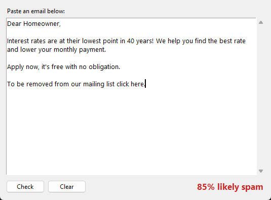
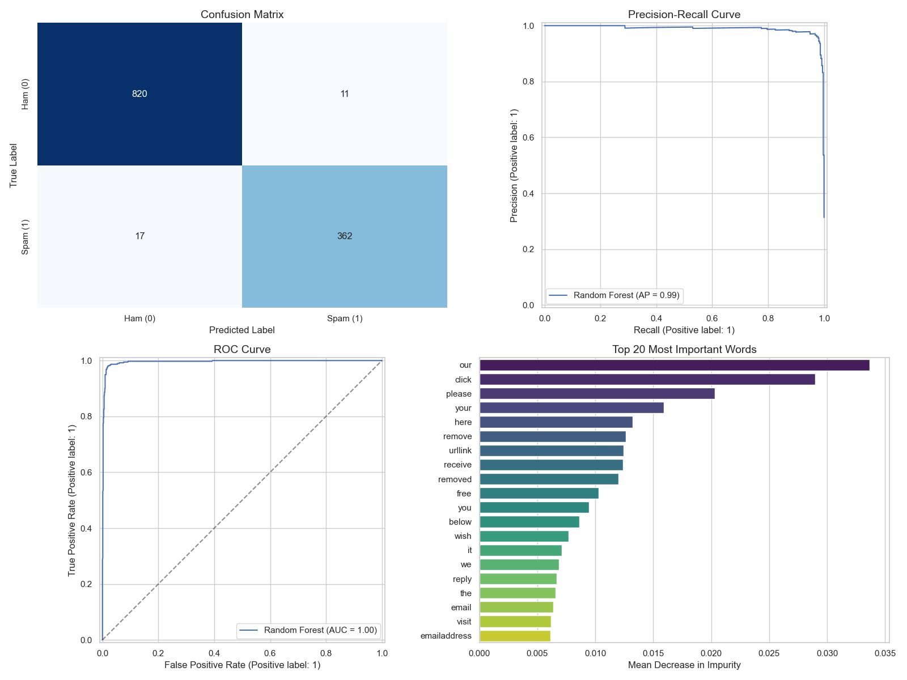

# Spam Filter

[](https://github.com/BenJunkins/Machine-Learning-Portfolio/actions/workflows/spam-filter.yml)

A spam filter built with a TF-IDF vectorizer and a Random Forest from scikit-learn, trained on the
Apache SpamAssassin public corpus. It comes with a small window where you can paste an email and see
how likely it is to be spam, and a web API that gives the same answer over HTTP.



## Setup

Requires Python 3.11 or newer. This project has its own requirements (scikit-learn is pinned so the
saved model loads), and all the commands below are run from this folder.

```bash
cd projects/spam-filter
pip install -r requirements.txt
```

## Checking an email

```bash
python -m spam_filter
```

Paste an email into the window and click **Check** (or press Ctrl+Enter). You can paste just the body
text or the full raw email with headers (for example from Gmail's "Show original"). The percentage is
the share of trees in the forest that voted spam. It shows green below 40%, red at 60% and above, and
anything in between is marked as unsure.

A trained model is already included in `models/`, so this works right after installing the requirements.

## Web API

The same model is served over HTTP with FastAPI. The API has its own, smaller requirements file.

```bash
pip install -r requirements-api.txt
uvicorn spam_filter.api:app
```

Open http://127.0.0.1:8000/docs to try it in the browser, or send a request:

```bash
curl -X POST http://127.0.0.1:8000/predict \
  -H "Content-Type: application/json" \
  -d '{"email": "Congratulations! You have been selected to receive a FREE $1000 gift card. Click here to claim your prize: http://www.example.com/claim"}'
```

```json
{ "spam_probability": 0.7591, "label": "spam" }
```

| Endpoint        | What it does                                                                                                                                                         |
| --------------- | -------------------------------------------------------------------------------------------------------------------------------------------------------------------- |
| `POST /predict` | Takes `{"email": "..."}` (body text or a full raw email) and returns the spam probability and a label: `ham` below 0.4, `spam` at 0.6 and above, `unsure` in between |
| `GET /health`   | Returns `{"status": "ok"}` once the model is loaded                                                                                                                  |
| `GET /docs`     | Interactive documentation                                                                                                                                            |

To run it in a container instead:

```bash
docker build -t spam-filter-api .
docker run --rm -p 127.0.0.1:8000:8000 spam-filter-api
```

To run the checks:

```bash
pip install -r requirements-dev.txt
ruff check .
pytest
```

GitHub Actions runs the same checks on every change, then builds the image and sends it a request.

## Training the model yourself

```bash
python -m spam_filter.download   # downloads the dataset into data/
python -m spam_filter.train      # searches for the best parameters and saves the model
python -m spam_filter.evaluate   # prints test set scores and shows the plots below
```

Training takes about a minute. To use your own emails instead, put one raw email per file in
`data/ham` and `data/spam` and run the train step.

## How it works

1. **Text extraction** - Each email is parsed and the plain text and HTML parts of the body are pulled
   out. HTML tags are stripped, quoted replies and leftover MIME boundary lines are removed, and links
   and email addresses are replaced with placeholder words.
2. **Removing duplicates** - 352 duplicate emails (mostly spam) and 19 emails with no text are dropped
   before splitting, so the same email can't end up in both the training and test sets.
3. **Features** - A TF-IDF vectorizer turns the text into word weights.
4. **Model** - A Random Forest classifier. `RandomizedSearchCV` tries 20 parameter combinations with
   3-fold cross validation, scored on F0.5 so precision counts more than recall. Marking a real email
   as spam is worse than letting a spam email through.
5. **Evaluation** - 20% of the emails are held out as a test set (stratified, fixed seed).

The link/address cleanup matters more than it sounds. Most of the ham in this dataset comes from
mailing lists, and without it the model mostly learned to spot list footers and archive URLs, which
don't show up in emails people actually paste in.

## Results

On the 1,135 email test set, using a 50% cutoff:

|      | Precision | Recall | Support |
| ---- | --------- | ------ | ------- |
| Ham  | 0.976     | 0.989  | 820     |
| Spam | 0.970     | 0.937  | 315     |

Accuracy is 97.4% and ROC AUC is 0.995.



### Real emails marked as spam

9 of the 820 real emails (1.1%) get marked as spam, while 20 of the 315 spam emails (6.3%) get
through, so the model already leans toward letting spam through. Moving the cutoff trades one for
the other:

| Cutoff | Real emails marked as spam | Spam that gets through |
| ------ | -------------------------- | ---------------------- |
| 40%    | 13 (1.6%)                  | 10 (3.2%)              |
| 50%    | 9 (1.1%)                   | 20 (6.3%)              |
| 60%    | 7 (0.9%)                   | 43 (13.7%)             |
| 70%    | 1 (0.1%)                   | 80 (25.4%)             |

Scoring the search on F1 instead of F0.5 picked the same parameters, so the cutoff is the real lever
here, not the tuning.

### Overfitting

The model scores close to 100% on its own training data, which is normal for a random forest. The
check that matters is how it does on emails it hasn't seen, and 5-fold cross validation on the
training set lines up with the test set (1.0% and 1.1% of real emails marked as spam). Validation F1
climbs quickly at first (0.865 to 0.913 going from 726 to 1,452 training emails) and then slowly
(0.935 at 3,632), so more of the same data would help a little but not much.

## Project structure

```
spam_filter/
    api.py          web API
    app.py          popup window
    predict.py      loading the model and scoring an email
    download.py     downloads the SpamAssassin corpus
    emails.py       email parsing, text cleanup, loading the dataset
    train.py        parameter search and saving the model
    evaluate.py     test set scores and plots
tests/
    test_api.py     requests against the API
    test_cleanup.py the fast text cleanup gives the same output as the original, and stays fast
    test_predict.py label thresholds
    original_cleanup.py  the cleanup exactly as the model was trained with it
models/
    spam_classifier.pkl
images/
Dockerfile
```

## Dataset

[Apache SpamAssassin public corpus](https://spamassassin.apache.org/old/publiccorpus/), using
`easy_ham`, `easy_ham_2` and `hard_ham` (4,150 ham) and `spam` and `spam_2` (1,896 spam). After
removing duplicates and empty emails that leaves 4,098 ham and 1,577 spam. Copyright for the messages
stays with their original senders, so the emails aren't included in this repo and are downloaded
instead.

## Limitations

The emails are from 2002 to 2005 and most of the ham is from tech mailing lists. Newer emails like
password resets, newsletters and appointment reminders, and modern scams too, often score between
40% and 60%, which is why the popup marks that range as unsure instead of calling it either way. The
percentage is a rough signal, not a guarantee.

The web API is a demo, not a hardened service. Requests are capped at 100,000 characters, and the
text cleanup is tested against input built to slow it down. One slow case is left, inside Python's
own email parser: a raw email whose Content-Type header carries thousands of parameters takes a few
seconds. There is also no rate limiting, so both would need attention before it went on the public
internet.
